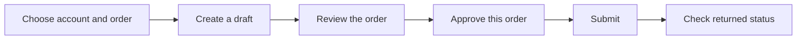

<p align="center">
  <a href="https://tradeit.app">
    <picture>
      <source media="(prefers-color-scheme: dark)" srcset="skills/trade-it-mcp/assets/trade-it-wordmark-dark.svg">
      <source media="(prefers-color-scheme: light)" srcset="skills/trade-it-mcp/assets/trade-it-wordmark-light.svg">
      
    </picture>
  </a>
</p>

<h1 align="center">Trade It</h1>

<p align="center">Your brokerage accounts, connected to your AI assistant.</p>
<p align="center">
  <a href="https://docs.tradeit.app/mcp">Documentation</a> ·
  <a href="https://docs.tradeit.app/installation">MCP setup</a> ·
  <a href="https://docs.tradeit.app/brokerages">Supported brokerages</a> ·
  <a href="https://github.com/trade-it-inc/skills">For developers</a>
</p>

Review brokerage accounts, holdings, and orders, look up assets, and review trades with your AI assistant. The **Trade It** plugin bundles a hosted MCP connection and a workflow skill. Available tools depend on your client and permissions.

Building a product with our SDK or API? Use **[Trade It Developer](https://github.com/trade-it-inc/skills)**. Both offerings are available through the shared Trade It marketplace in Codex and Claude Code.

## Install the plugin

### Codex

```bash
codex plugin marketplace add trade-it-inc/skills
codex plugin add trade-it@trade-it
```

Start a new session and authenticate the Trade It MCP connection when prompted. Select Trade It through `/skills` or the `$` picker, or ask to see your accounts. [Codex plugin documentation](https://developers.openai.com/plugins/build/plugins)

### Claude Code

```text
/plugin marketplace add trade-it-inc/skills
/plugin install trade-it@trade-it
```

Start a new session and use `/mcp` to authenticate Trade It. Invoke `/trade-it:trade-it-mcp` or ask about your brokerage accounts. [Claude Code plugin documentation](https://code.claude.com/docs/en/discover-plugins)

### Cursor

1. Open **Settings → Plugins**.
2. Paste `https://github.com/trade-it-inc/trade-it-mcp` into the plugin search box.
3. Install **Trade It**, then connect its MCP server and authenticate when prompted.

### VS Code / GitHub Copilot

1. Enable **`chat.plugins.enabled`** in settings.
2. Run **Chat: Install Plugin From Source** in the Command Palette.
3. Enter `https://github.com/trade-it-inc/trade-it-mcp` and install **Trade It**.
4. Start a new chat and authenticate the MCP connection when prompted.

See the [VS Code plugin documentation](https://code.visualstudio.com/docs/agent-customization/agent-plugins).

### Other assistants

Add this remote server using your assistant's [MCP connection settings](https://docs.tradeit.app/installation):

```text
https://mcp.tradeit.app/mcp
```

Use **Streamable HTTP**. Trade It runs the server; no local server, Node.js, or React SDK is needed for a direct remote connection. The old HTTP+SSE transport is no longer supported. `/sse` is only a legacy URL alias for the current handler; it is not an SSE connection endpoint.

If your assistant also supports standalone skills, you can optionally install the workflow guidance:

```bash
npx skills add trade-it-inc/trade-it-mcp --skill trade-it-mcp
```

This optional installer requires Node.js/npm. Run it from your project, or add `--global` for a personal installation. It installs instructions only; configure the MCP connection separately. Choose either the plugin or a standalone skill copy to avoid duplicate guidance.

## Connect your account

1. Authenticate through the browser-based OAuth flow when your assistant encounters an MCP/API `401`.
2. Review and approve the requested access to your Trade It account.
3. Connect a brokerage on [Trade It](https://tradeit.app) if you have not already.

If your client supports bearer headers, you can instead use a [user-created API key](https://tradeit.app/account/api-keys). Keep keys in the client's credential settings. See [MCP authentication](https://docs.tradeit.app/mcp.html#authentication) and [API authentication](https://docs.tradeit.app/api.html#authentication).

Installing the plugin and authorizing an account are separate steps. Your connections belong to your Trade It account. A personal MCP connection does not grant access to another user's accounts.

## Try it

- “Show my connected accounts and holdings.”
- “What is the status of my recent orders?”
- “Prepare an order for me to review before I decide whether to place it.”
- “Create a shareable Trade Link.”

## Tools

| Tool | Purpose |
| --- | --- |
| `hello` | Introduce the server and its capabilities. |
| `get_accounts` | Read linked accounts, balances, cash, and buying power. |
| `get_holdings` | Read positions for a selected account. |
| `get_trades` | Read order history and statuses with cursor pagination. |
| `search_assets` | Look up stocks and crypto assets with price information. |
| `create_trade` | Prepare a stock or crypto order. |
| `create_options_trade` | Prepare an order with concrete option or equity legs. |
| `execute_trade` | Submit a reviewed draft after approval of that specific order. |
| `cancel_trade` | Cancel a draft or request cancellation of a submitted order. |
| `create_trade_link` | Create a shareable trade configuration for review on Trade It. |

The authenticated server's tool list and schemas are authoritative. Some clients offer account data and Trade Links without trading tools. See the [workflow notes](skills/trade-it-mcp/references/tools.md) and [full tool documentation](https://docs.tradeit.app/tools/).

## Review before trading

Prefer a draft that you can review before execution. Account auto-execution settings can cause creation itself to submit an order; approve the exact order before any call that could submit it. The skill does not change those settings.



This diagram shows the draft workflow. An accepted order is not necessarily filled, and a cancellation request is not necessarily a completed cancellation. Check the returned status. Creating a Trade Link generates a URL; it does not place an order.

## Updates and troubleshooting

Update or remove the plugin through your assistant's plugin manager. For standalone skills, use `npx skills update trade-it-mcp` or `npx skills remove trade-it-mcp` in the installation's project/global scope.

| Symptom | Next step |
| --- | --- |
| Sign-in required or token expired | Complete OAuth again, or check the configured API key. |
| Tool unavailable | Inspect the authenticated tool list and granted permissions. |
| Old SSE connection fails | Switch to Streamable HTTP at `/mcp`. |
| Balances or holdings appear stale | Check available timestamps; request refresh only when supported and eligible. |
| Rate limited | Honor the returned retry/cooldown information. |
| Order submission outcome is uncertain | Inspect recent orders before trying to submit again. |

Brokerage support, order capabilities, and plan eligibility change over time. Use [supported brokerages](https://docs.tradeit.app/brokerages), the current docs, and the connected server's responses instead of a copied brokerage-ID list.

## This repository

This repository distributes connection metadata, plugin manifests, and user workflow guidance. The hosted server implementation lives in the [Trade It application repository](https://github.com/trade-it-inc/trade-it/tree/main/workers/mcp).

| File | Purpose |
| --- | --- |
| `plugin.json` | Portable Agent Plugins manifest. |
| `mcp.json` | Portable MCP connection using `streamable-http`. |
| `.mcp.json` | Native compatibility connection using `http`. |
| `.codex-plugin/`, `.claude-plugin/`, `.cursor-plugin/` | Assistant-specific manifests and presentation. |
| `skills/trade-it-mcp/` | User workflow skill, references, and branding. |
| `server.json` | Official MCP Registry metadata for `app.tradeit/mcp`. |
| `glama.json` | Glama directory maintainer metadata. |

Portable and native MCP files describe the same connection; clients load their supported format. Plugin versions and registry metadata versions are independent. See [CONTRIBUTING.md](CONTRIBUTING.md) for maintenance and registry publishing, and the shared [plugin release instructions](https://github.com/trade-it-inc/skills/blob/main/RELEASING.md).

## Help

- Setup and usage: [Trade It documentation](https://docs.tradeit.app/mcp).
- Account or connection support: [contact Trade It](https://tradeit.app/contact).
- Incorrect instructions or package metadata: [open an issue](https://github.com/trade-it-inc/trade-it-mcp/issues) with sanitized details.
- Vulnerabilities or exposed credentials: follow [SECURITY.md](SECURITY.md).

Repository content is available under [CC0-1.0](LICENSE). Trading involves risk. Trade It does not provide investment advice; review orders before approving them.
